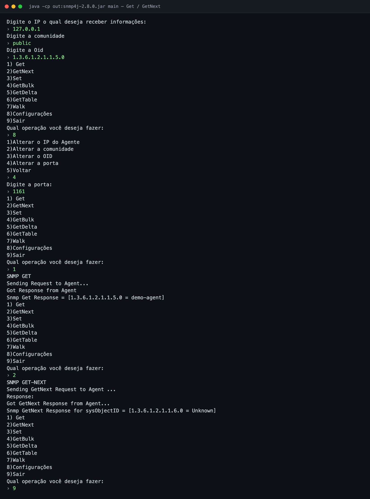
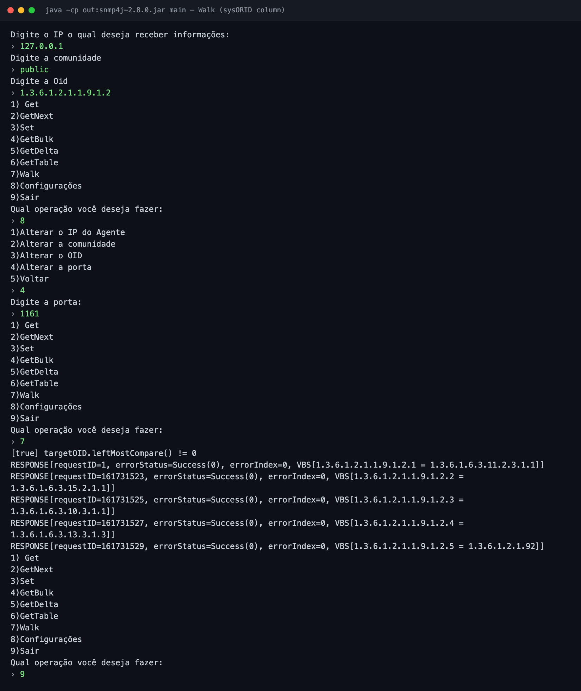
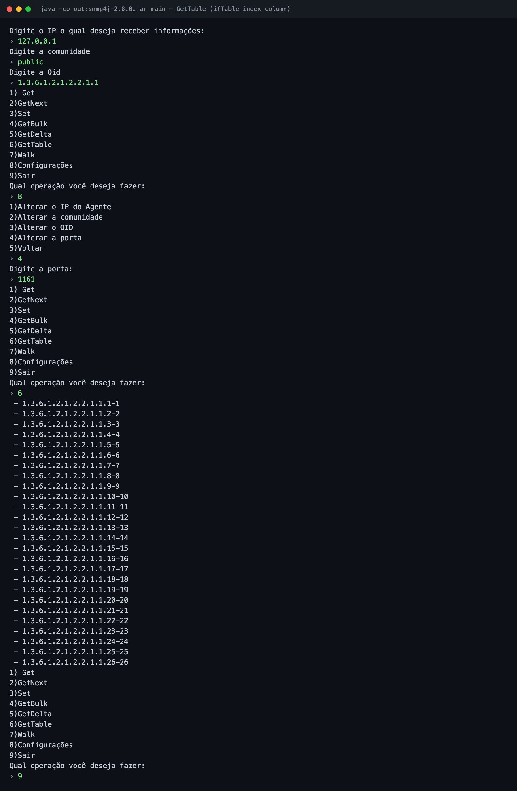

# 📡 snmp4j — SNMP Manager (CLI)

> A small interactive command-line SNMP manager written in Java on top of the [SNMP4J](https://www.snmp4j.org/) library: query and change values on network devices from a menu.

---

## Project at a glance

| | |
|---|---|
| **Date** | October 23 – 30, 2019 |
| **Context** | University network lab assignment on SNMP / network management (PUCRS, *Laboratório de Redes*) |
| **Author** | João Davila ([@joaodavil4](https://github.com/joaodavil4)); some commits were made from the lab's shared machine |
| **Stack** | Java, SNMP4J 2.8.0, IntelliJ IDEA |
| **Language** | Menus and prompts are in Brazilian Portuguese |

## The purpose

SNMP (Simple Network Management Protocol) is how network devices (routers, switches, servers, printers) expose their status and settings. The assignment was to build a **manager**: a program that talks to an SNMP *agent* and implements the core protocol operations by hand using a client library, instead of using ready-made tools such as `snmpget` or `snmpwalk`.

## What it does

On start it asks for the agent's **IP**, the **community string** and an **OID**, then shows a menu:

| Option | Operation | What it does |
|---|---|---|
| 1 | **Get** | Reads the value of the configured OID. |
| 2 | **GetNext** | Returns the next OID after the configured one. |
| 3 | **Set** | Writes a new value (sent as an `OctetString`) to the OID. |
| 4 | **GetBulk** | Reads many values at once (asks for *non-repeaters* and *max-repetitions*). |
| 5 | **GetDelta** | Samples a counter N times, every T seconds, and prints the difference between samples (useful for traffic rates). |
| 6 | **GetTable** | Fetches a whole table column set with `TableUtils`. |
| 7 | **Walk** | Repeats GetNext until it leaves the subtree. |
| 8 | **Configurações** | Changes the IP, community, OID or port (default `161`). |
| 9 | **Sair** | Exits. |

## Screenshots

These are terminal captures of real runs against a local `net-snmp` agent (October 2026), rendered to images with the typed inputs in green. Agent `127.0.0.1`, community `public`, and the port changed to `1161` through the configuration menu. The `sysDescr` value was redacted because it contained a hostname.

**Get and GetNext** on `sysName.0` (`1.3.6.1.2.1.1.5.0`):



**Walk** over the `sysORID` column (`1.3.6.1.2.1.1.9.1.2`):



**GetTable** over the `ifIndex` column of the interfaces table (`1.3.6.1.2.1.2.2.1.1`):



## Running it

The SNMP4J 2.8.0 jar is committed in `.idea/libraries/`.

```bash
javac -encoding UTF-8 -cp .idea/libraries/snmp4j-2.8.0.jar -d out src/*.java
java -cp out:.idea/libraries/snmp4j-2.8.0.jar main
```

To try it without a real device, start a local agent on an unprivileged port (net-snmp):

```bash
printf 'rocommunity public\nagentaddress udp:127.0.0.1:1161\n' > snmpd.conf
snmpd -f -C -c snmpd.conf
```

Then use `127.0.0.1`, community `public`, and set the port to `1161` from the configuration menu.

## Structure

```
src/main.java      Menu, input handling and every SNMP operation
src/Configs.java   Agent IP, port, community and OID holder
```

## Limitations of the time (and of this code)

- **SNMP v1 only**, with a community string sent in clear text; there is no v2c or v3 (authentication/encryption) support.
- **Copy-pasted request setup.** Every operation builds its own transport, target and PDU, and the same block is repeated in almost every method instead of living in one helper. A new UDP socket is opened per request.
- **GetDelta crashes on large counters.** It parses the value with `Integer.parseInt`, so a 32-bit counter above 2,147,483,647 (for example `ifInOctets`) throws `NumberFormatException`, and a non-numeric value fails the same way. A `long` would fix it, and counter wrap-around is not handled either.
- **GetBulk is not really bulk.** The manager is hard-wired to SNMP v1, which has no GETBULK, so agents answer with a single GetNext-style result. Bulk needs v2c.
- **Minimal error handling.** Timeouts and null responses are mostly printed.
- **Misleading messages.** GetNext prints "for sysObjectID" for any OID, and Walk prints debug lines like `[true] ...` when it stops.
- **Set is always a string.** It sends the value as an `OctetString` regardless of the OID's real type, so it only works for string objects such as `sysContact`.
- **Dead code.** `initSnmp()` and `setOid()` are never used.
- **Naming and layout.** A lowercase `main` class and no packages; IDE files (`.idea/`, `out/`) are committed.
- **No automated tests.**

## Credits

- [SNMP4J](https://www.snmp4j.org/) by Frank Fock / AGENTPP, licensed under Apache 2.0.
- Course and lab environment: PUCRS, Laboratório de Redes.
